# Controller Installation

This guide describes how to configure and install the FanucX controller components required by the Python package.

The documented procedure was developed and tested in FANUC RoboGuide. Controller menus, available options, system variables, and status codes may differ depending on the controller generation, software version, and installed options.

---

## Tested environment

FanucX was developed and tested with the following virtual environment:

- RoboGuide version: `V9 Rev ZP`
- Robot model: `ARC Mate 120iD`
- Virtual controller: `R-30iB Plus`
- Virtual controller software version: `V9.40P/63`
- KAREL translator: `KTRANS V9.40 Build 39`
- FanucX protocol version: `1`


The tested virtual controller package reports:

```text
V9.40 - R-30iB Plus, 9.40396.63 04
(V9.40P/63 7DF5/63)
```

Initial configuration and functional testing should be performed in RoboGuide whenever possible before FanucX is deployed to a physical controller.

RoboGuide testing does not replace physical commissioning, controller validation, or the machine risk assessment required for the final installation.

---

## Required controller options

The tested FanucX configuration uses the following FANUC controller options:

| Option code | Option name | Purpose |
|---|---|---|
| `R632` | KAREL | Runs the compiled `FX_SERVER` KAREL program |
| `R648` | User Socket Messaging | Provides the TCP Socket Messaging connection used by FanucX |
| `R507` | ASCII Program Loader | Builds and loads the `FXMOTION.LS` TP source program |

Option availability and naming can depend on the controller generation, software version, and installed option package.

Verify the installed controller options before attempting to build, load, or run the FanucX controller programs.

---

## Controller files

The FanucX controller sources are located in:

```text
fanucx/controller/
├── FX_SERVER.KL
├── FXMOTION.LS
└── includes/
    ├── fx_errors.kl
    ├── fx_protocol.kl
    ├── fx_string_utils.kl
    └── ...
```

`FX_SERVER.KL` is the main KAREL TCP server and protocol dispatcher.

`FXMOTION.LS` is the TP Motion executor. It is not a KAREL program.

The files in `includes/` contain the KAREL routines included when `FX_SERVER.KL` is compiled.

---

# Socket Messaging configuration

## Open the server configuration

Open the controller communication configuration from the teach pendant:

1. Press `MENU`
2. Select `SETUP`
3. Select `Host Comm`

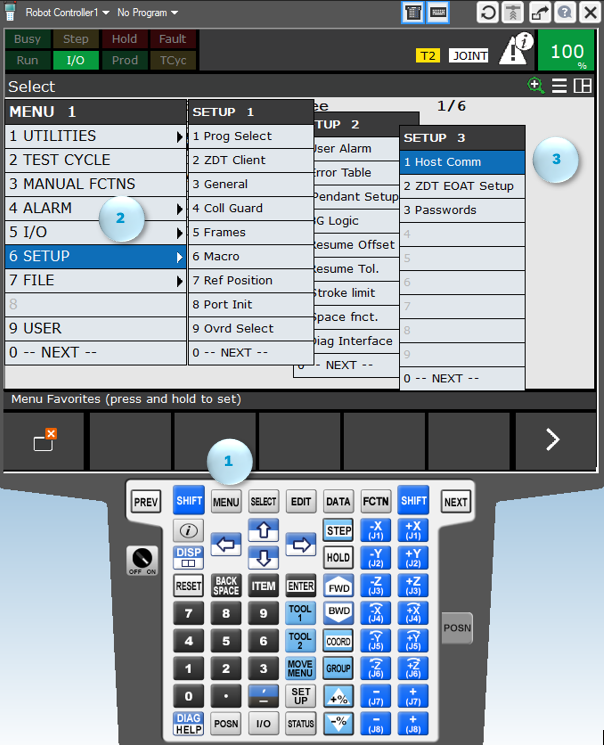

On the `SETUP Protocols` screen:

1. Press `SHOW`
2. Select `Servers`

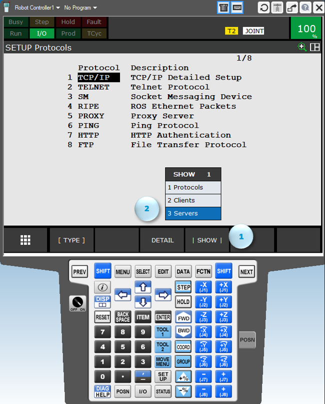

The controller displays the available server slots from `S1:` through `S8:`.

1. Select `S3:`, or another available slot
2. Press `DETAIL`

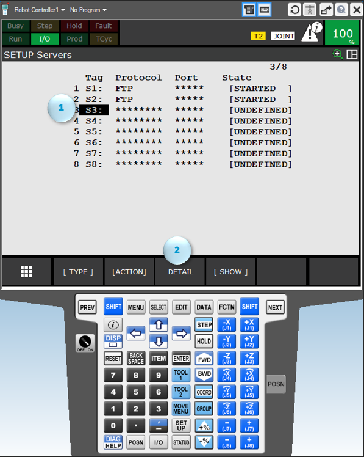

The current `FX_SERVER` program uses `S3:`. In the illustrated controller configuration, `S1:` and `S2:` are already assigned to FTP services and `S3:` is the first available slot.

A different slot can be used, but every `S3:` reference in `FX_SERVER.KL` must be changed to the selected slot:

```karel
MSG_DISCO('S3:', connection_status)
MSG_CONNECT('S3:', connection_status)
OPEN FILE socket_file('rw', 'S3:')
```

## Select the Socket Messaging protocol

1. Move the cursor to the `Protocol` field
2. Press `CHOICE`
3. Select `SM`

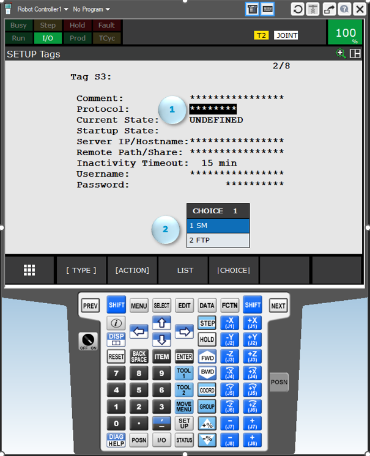

The `Protocol` field should display:

```text
SM
```

## Define and start the server slot

1. Press `ACTION`
2. Select `DEFINE`
3. Press `ACTION` again
4. Select `START`

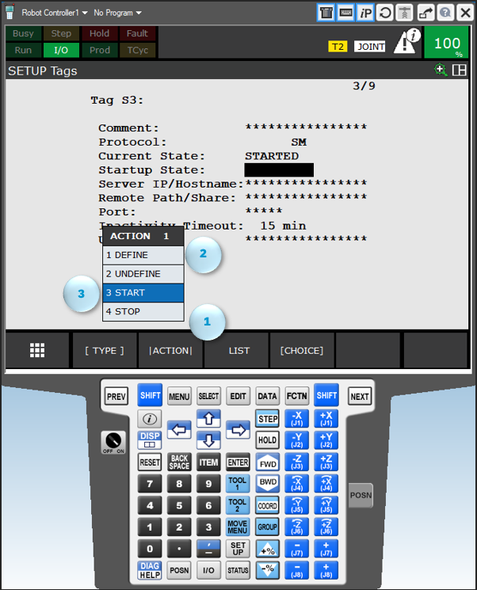

After the server slot starts successfully, `Current State` should display:

```text
STARTED
```

## Enable automatic Socket Messaging startup

1. Move the cursor to the `Startup State` field
2. Press `CHOICE`
3. Select `START`

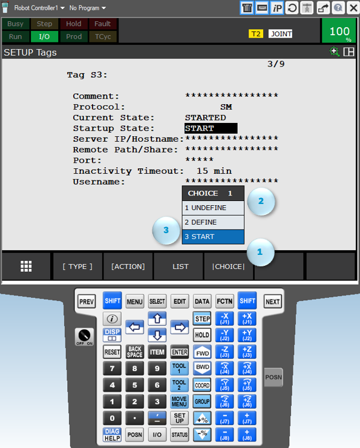

`Startup State` should display:

```text
START
```

This setting starts the configured Socket Messaging service automatically after a controller restart. It does not start the `FX_SERVER` KAREL program.

---

# Server port configuration

## Open the system variables

The TCP server port is configured in the controller system variables. The same port must later be supplied to the Python client.

1. Press `MENU`
2. Select `0 -- NEXT --`

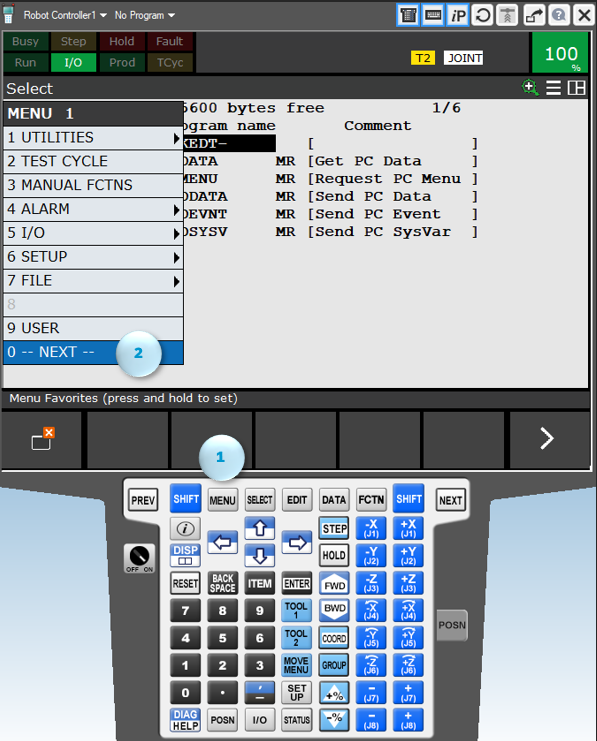

On the second menu page:

1. Select `SYSTEM`
2. Select `Variables`

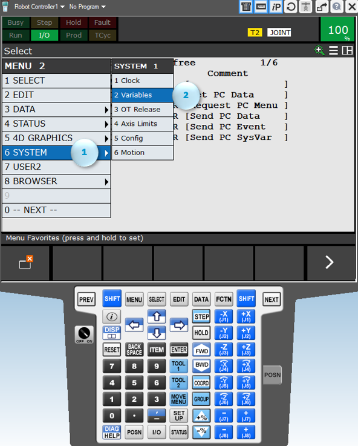

In the `SYSTEM Variables` screen:

1. Locate `$HOSTS_CFG`
2. Select `$HOSTS_CFG`
3. Press `DETAIL`

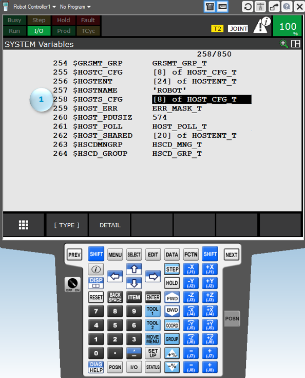

`$HOSTS_CFG` contains the configuration of the controller communication slots.

| Socket slot | System-variable element |
|---|---|
| `S1:` | `$HOSTS_CFG[1]` |
| `S2:` | `$HOSTS_CFG[2]` |
| `S3:` | `$HOSTS_CFG[3]` |
| `S4:` | `$HOSTS_CFG[4]` |
| `S5:` | `$HOSTS_CFG[5]` |
| `S6:` | `$HOSTS_CFG[6]` |
| `S7:` | `$HOSTS_CFG[7]` |
| `S8:` | `$HOSTS_CFG[8]` |

For the default FanucX configuration using `S3:`, open:

```text
$HOSTS_CFG[3]
```

## Set the server port

Confirm that the array index shown at the top of the screen matches the selected socket slot:

```text
S3: -> $HOSTS_CFG[3]
```

Locate `$SERVER_PORT` and enter:

```text
12345
```

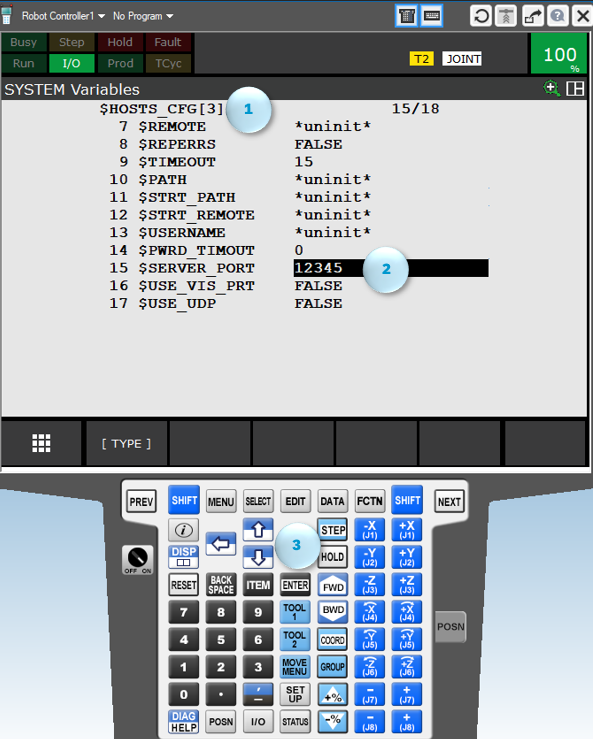

Confirm the value with `ENTER`.

The configured port must match the `port` argument used by the Python client:

```python
robot = Robot(
    host="127.0.0.1",
    port=12345,
    timeout=5,
)
```

If another port is configured in `$SERVER_PORT`, use that same value in Python.

The examples use `127.0.0.1` because the Python client and RoboGuide virtual controller run on the same computer.

For a physical controller, or a virtual controller accessed from another computer, use the controller address available in the configured network environment. Configure controller networking according to the applicable FANUC controller documentation.

---

# Adding the source files in RoboGuide

## Add the controller files

1. Locate the virtual controller `Files` node in the RoboGuide Cell Browser
2. Right-click `Files`
3. Select `Add`
4. Add:

```text
FX_SERVER.KL
FXMOTION.LS
```

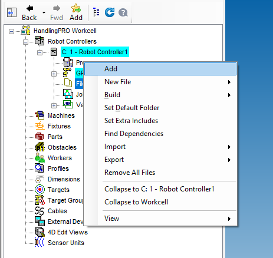

## Configure the KAREL include path

`FX_SERVER.KL` uses multiple `%INCLUDE` files during compilation.

1. Right-click the `Files` node
2. Select `Set Extra Includes`
3. Select the directory containing the FanucX KAREL include files
4. Confirm the path

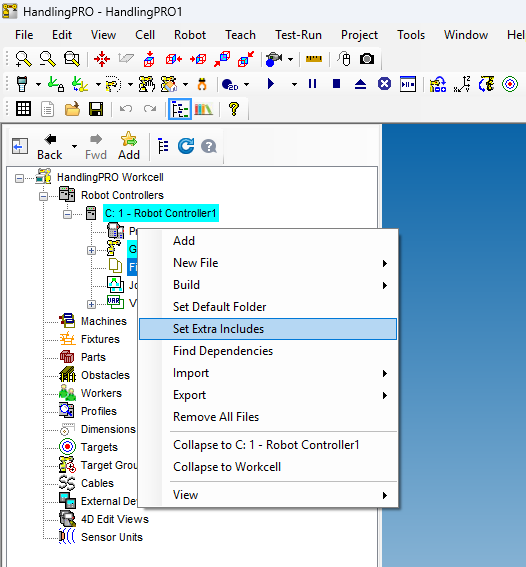

For the repository layout shown earlier, select:

```text
fanucx/controller/includes/
```

The directory must contain every source referenced by the `%INCLUDE` directives in `FX_SERVER.KL`.

---

# Building the controller programs

Both controller source files must be built:

```text
FXMOTION.LS
FX_SERVER.KL
```

## Build the TP Motion executor

1. Expand the virtual controller `Files` node
2. Right-click `FXMOTION.LS`
3. Select `Build`

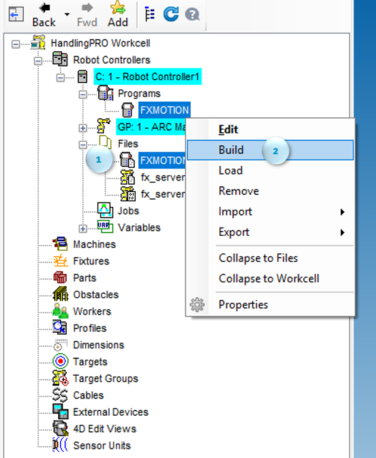

A successful translation is indicated by:

```text
Translation complete.
```

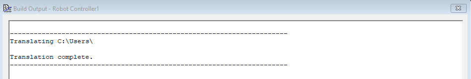

After a successful build, the TP program appears under the controller `Programs` node as:

```text
FXMOTION
```

The KAREL server starts and aborts this program by the same controller program name:

```karel
RUN_TASK('FXMOTION', 0, FALSE, TRUE, 1, run_task_status)
ABORT_TASK('FXMOTION', TRUE, TRUE, abort_status)
```

The program name in `FX_SERVER.KL` must match the program generated from `FXMOTION.LS`.

## Build the KAREL server

1. Open `FX_SERVER.KL` from the `Files` node
2. Confirm that the source contains the `PROGRAM fx_server` declaration and expected `%INCLUDE` directives
3. Select `Build`

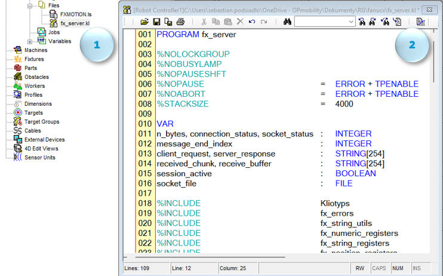

A successful KAREL compilation reports:

```text
Translation successful
```

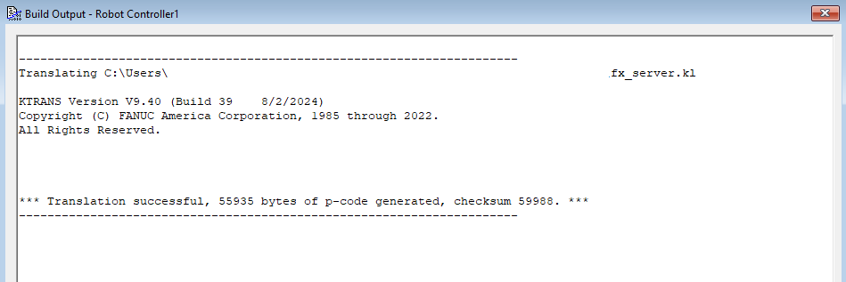

The tested build used:

```text
KTRANS Version V9.40 (Build 39)
```

The illustrated build generated:

```text
55935 bytes of p-code
```

The exact p-code size and checksum can change when the source, include files, or compiler version changes. A different size does not by itself indicate an error.

After a successful build, the compiled program appears in the virtual controller program list as:

```text
FX_SERVER
```

If compilation reports a missing include file, verify the directory configured under `Set Extra Includes` and confirm that the filenames match the `%INCLUDE` directives.

---

# Reserved controller resources

FanucX Motion uses reserved Numeric Registers and Position Registers, including:

```text
PR[90]
PR[93]
R[191]-R[199]
```

Confirm that these resources are available before starting Motion operations. TP programs, KAREL programs, PLC logic, and external applications must not modify them while a FanucX Motion is active.

See `reserved-resources.md` for the complete resource list and field meanings.

---

# Starting FX_SERVER

After both controller programs have been built:

1. Open the controller program list
2. Locate and highlight `FX_SERVER`
3. Press `ENTER`
4. Hold `SHIFT`
5. While holding `SHIFT`, press `FWD`

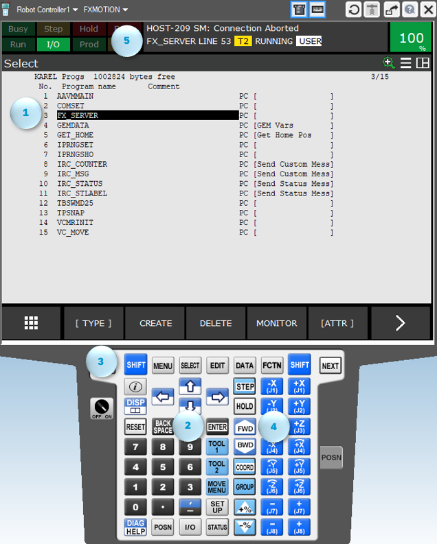

After startup, the controller status area should show:

```text
FX_SERVER
RUNNING
```

`FX_SERVER` waits for and services a TCP connection from the FanucX Python client.

A message such as:

```text
HOST-209 SM: Connection Aborted
```

can appear when a previous Socket Messaging connection was closed or reset. Confirm that `FX_SERVER` remains `RUNNING` and test a new client connection.

The Socket Messaging `Startup State = START` setting does not automatically run `FX_SERVER`. After a controller restart, start `FX_SERVER` again from the program list.

---

# Testing the installation

## Install the Python package

From a local project checkout:

```bash
python -m pip install .
```

When FanucX is available from the configured package index, install the released package using its published package name and version.

## Test the RoboGuide connection

When Python and RoboGuide run on the same computer:

```python
from fanucx import Robot


robot = Robot(
    host="127.0.0.1",
    port=12345,
    timeout=5,
)

robot.connect()

try:
    print(robot.r[1])
    print(robot.cartesian())
    print(robot.joints())
finally:
    robot.disconnect()
```

A successful test confirms that:

- the Socket Messaging service is active,
- `FX_SERVER` is running,
- the TCP port is correct,
- the FanucX handshake is compatible,
- requests and responses can be exchanged.

## Recommended functional test order

Test operations in this order:

1. Connect and disconnect
2. Read a Numeric Register
3. Read I/O
4. Read a variable
5. Read the latest alarm
6. Read User Frame, Tool Frame, and Payload data
7. Read current Cartesian and Joint positions
8. Run `is_reachable()`
9. Run a low-speed `movej()` in RoboGuide
10. Run a low-speed `movel()` in RoboGuide
11. Test Motion abort

Do not begin Motion testing until the reserved resources, frames, payload, Motion Group, speed, termination, and targets have been verified.

---

# Troubleshooting

## Connection refused

Check that:

- the configured socket slot uses protocol `SM`,
- `Current State` is `STARTED`,
- `$SERVER_PORT` matches the Python `port`,
- `FX_SERVER` is `RUNNING`,
- the selected `S1:` through `S8:` slot matches the slot referenced in `FX_SERVER.KL`.

## Connection timeout

Check the controller address, host firewall, network route, Socket Messaging state, and configured port.

For the local RoboGuide setup documented here, use:

```text
127.0.0.1
```

## Invalid handshake

Confirm that the client connects to the FanucX Socket Messaging port rather than another service. The expected protocol-version handshake is:

```text
FANUCX|1|READY
```

## KAREL include file not found

Check `Set Extra Includes` and confirm that all include files referenced by `FX_SERVER.KL` exist in the configured directory.

## FXMOTION does not appear in the program list

Rebuild `FXMOTION.LS` and confirm that the Build Output reports:

```text
Translation complete.
```

Also confirm that the generated program name is `FXMOTION` and matches the `RUN_TASK` and `ABORT_TASK` calls in `FX_SERVER.KL`.

## FX_SERVER stops after a restart

`Startup State = START` applies to the Socket Messaging service, not to the KAREL program. Start `FX_SERVER` again with `SHIFT` and `FWD`.

## Motion request is rejected

Check that:

- `FXMOTION` exists,
- the reserved registers are available,
- no FanucX Motion is already Accepted or Running,
- Motion Group 1 is configured,
- the selected User Frame, Tool Frame, and Payload are valid,
- the target and speed satisfy the documented Motion requirements.

---

# Safety

FanucX Motion commands can move the robot immediately.

Perform the first installation and functional tests in RoboGuide whenever possible. Before using a physical robot:

- validate all controller programs and options,
- confirm the reserved resources,
- verify Motion Group, User Frame, Tool Frame, and Payload configuration,
- verify targets, units, speeds, and termination settings,
- confirm a clear path and workspace,
- use the controller and cell safety functions required by the installation,
- complete commissioning and the machine risk assessment.

FanucX is not safety-rated and does not replace DCS, guarding, emergency-stop circuits, enabling devices, safety PLC logic, controller safety logic, or the machine risk assessment.
